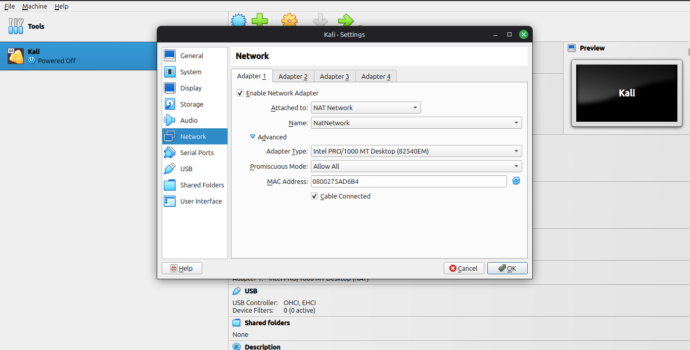
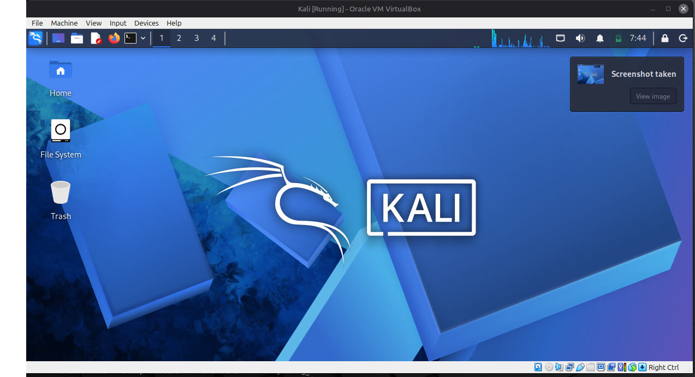
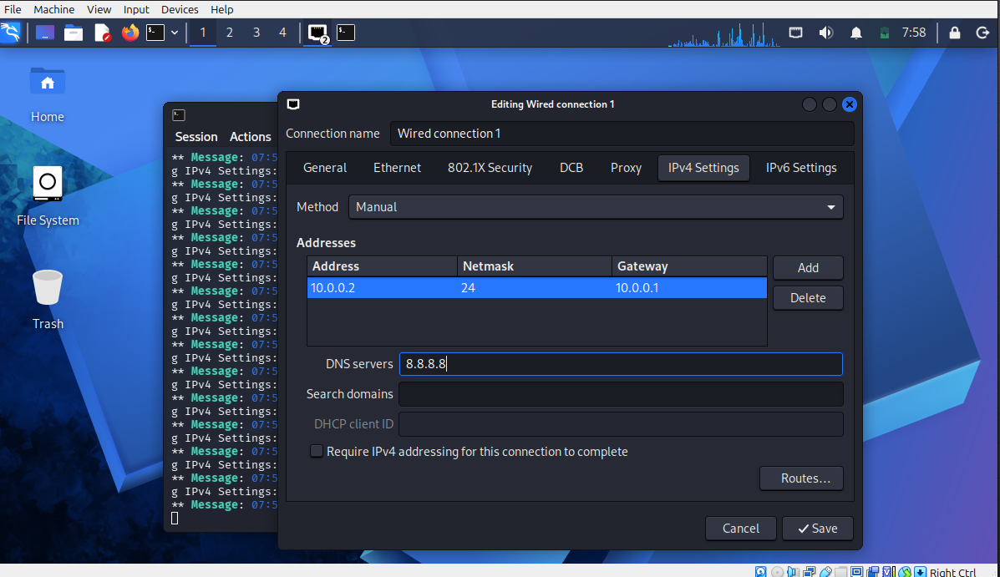

🔐 Cybersecurity Lab Environment Setup

Building a virtual lab for penetration testing and ethical hacking practice

Networkwalks | Cybersecurity Internship | Project 01

📌 Project Overview

This project focuses on setting up a virtual cybersecurity and penetration-testing laboratory using VirtualBox and Kali Linux, hosted on Linux Mint.

The purpose of this lab is to create a controlled environment for practicing cybersecurity tools, network scanning, reconnaissance, vulnerability assessment, and other security-testing activities.

The lab uses a dedicated VirtualBox NAT Network so additional virtual machines can be connected later for authorized penetration-testing exercises.

🎯 Objectives

The main objectives of this project are to:

🖥️ Install and configure VirtualBox on Linux Mint.
🐉 Import and configure Kali Linux as a virtual machine.
🌐 Create a private NAT Network for the cybersecurity lab.
📡 Configure network connectivity and a static IP address.
🔎 Verify gateway connectivity, Internet access, and DNS resolution.
🧰 Verify that Nmap is installed and working.
📸 Create a clean VM snapshot for recovery.
📝 Document the complete setup, problems, and solutions.
🚀 Prepare the environment for future cybersecurity projects.
🛡️ Purpose of the Lab

This laboratory provides a virtual environment for learning and practicing authorized cybersecurity techniques.

It can be used for:

🔍 Network reconnaissance
📡 Port scanning
🛡️ Vulnerability assessment
📊 Packet analysis
🌐 Web application security testing
🧪 Security-tool experimentation
🖥️ Multi-VM penetration-testing exercises
⚠️ Ethical use: Only test systems you own or have explicit permission to assess.
🔒 Network isolation: A NAT Network allows connected VMs to communicate with each other and access external networks. For malware analysis or experiments requiring strict isolation, use a separate Internal Network without Internet access.
🏗️ Lab Architecture

The lab consists of a Linux Mint host running VirtualBox, with Kali Linux connected to the NatNetwork virtual network.

text
                    ┌──────────────────────┐
                    │       INTERNET       │
                    └──────────┬───────────┘
                               │
                    ┌──────────▼───────────┐
                    │   VirtualBox NAT     │
                    │  Outbound Connection │
                    └──────────┬───────────┘
                               │
              ┌────────────────────────────────┐
              │      NatNetwork                │
              │      10.0.0.0/24               │
              │                                │
              │   ┌────────────────────────┐   │
              │   │     Kali Linux VM      │   │
              │   │     10.0.0.2/24         │   │
              │   │     4 GB RAM            │   │
              │   │     2 CPU Cores        │   │
              │   └────────────────────────┘   │
              │                                │
              │       Future Target VMs        │
              └────────────────────────────────┘

Additional target machines can be added to the same virtual network in future projects.

⚙️ Lab Configuration
🧩 Component	⚙️ Configuration
🖥️ Host OS	Linux Mint
🧠 Host RAM	8 GB
⚡ Processor	Intel Core i5-7200U
🧰 Hypervisor	VirtualBox 7.0.20
🐉 Security OS	Kali Linux 2026.2
🧠 Kali RAM	4096 MB (4 GB)
⚙️ Kali CPU	2 cores
🌐 Virtual Network	NAT Network
📛 Network Name	NatNetwork
📡 Network Address	10.0.0.0/24
🐧 Kali IP Address	10.0.0.2/24 (static)
🚪 Default Gateway	10.0.0.1
🌍 DNS Server	8.8.8.8
🔮 Future VM Addresses	Subject to DHCP and IP allocation
💡 Resource allocation: Kali Linux is allocated 4 GB of the host's 8 GB RAM. Leave sufficient memory for Linux Mint and avoid running too many resource-intensive applications simultaneously.
🪜 Lab Setup Procedure
Step 1. Install 7-Zip

A compatible archive utility was used to extract the Kali Linux virtual-machine package, which was downloaded as a .7z archive.

On Linux Mint, try installing the available archive utility:

bash
sudo apt update
sudo apt install p7zip-full

If the package is unavailable in your Linux Mint version, use another compatible 7z extraction utility.

Step 2. Install VirtualBox

VirtualBox was installed on the Linux Mint host to create and manage virtual machines.

Tool: VirtualBox 7.0.20

🔗 Official download: VirtualBox Downloads

After installation, VirtualBox was opened to import and configure Kali Linux.

Step 3. Create the NAT Network

A dedicated NAT Network was created through VirtualBox Network Manager.

Network configuration:

text
Network Name: NatNetwork
IPv4 Prefix:  10.0.0.0/24
DHCP:         Enabled
IPv6:         Disabled

The IPv4 prefix was changed to 10.0.0.0/24 to match the planned lab addressing scheme.

A NAT Network was selected because multiple VMs connected to the same virtual network can communicate with one another while retaining outbound connectivity.

This setup prepares the lab for future attacker and target VMs.

Step 4. Import Kali Linux

Kali Linux was downloaded from the official Kali Linux website and imported into VirtualBox.

🔗 Official download: Get Kali Linux

The virtual machine was configured with the following resources:

text
Operating System: Kali Linux
RAM:              4096 MB
CPU Cores:        2
Network Adapter:  Adapter 1
Attached To:      NAT Network
Network Name:     NatNetwork

The network adapter was configured under:

Settings → Network → Adapter 1

After starting Kali Linux, DHCP initially assigned the address 10.0.0.4, confirming that the VM could obtain an address from the virtual network.

Step 5. Configure the Kali Linux Network

The active NetworkManager connection was identified using:

bash
nmcli connection show

The connection used in this setup was Wired connection 1, associated with eth0.

The static IPv4 configuration was applied using:

bash
sudo nmcli connection modify "Wired connection 1" \
  ipv4.method manual \
  ipv4.addresses 10.0.0.2/24 \
  ipv4.gateway 10.0.0.1 \
  ipv4.dns 8.8.8.8

sudo nmcli connection up "Wired connection 1"

Expected network settings:

Setting	Value
IP Address	10.0.0.2
Subnet Mask	255.255.255.0
Gateway	10.0.0.1
DNS Server	8.8.8.8

Verify the configuration:

bash
ip a show eth0
ip route
nmcli device show eth0

A static address makes it easier to reference the Kali machine during future lab exercises.

⚠️ Ensure 10.0.0.2 is not already in use and does not conflict with the DHCP pool. Configure the DHCP range or reservation appropriately.
Step 6. Create a Clean VM Snapshot

After completing the initial configuration and verification, a VirtualBox snapshot was created.

Snapshot name:

text
Clean Kali - Network Setup

The snapshot represents the clean baseline of the laboratory.

If a future exercise breaks the network configuration or changes the VM unexpectedly, the snapshot provides a recovery point.

📸 Best practice: Take a snapshot before installing additional tools or performing experimental security exercises.

🔎 Lab Verification

The following tests help verify the network configuration and installed security tools.

✅ Test	🧾 Command	🎯 Expected Result
🌐 Check IP address	ip a	eth0 shows 10.0.0.2/24
📡 Test gateway	ping -c 3 10.0.0.1	Successful replies
🌍 Test Internet	ping -c 3 8.8.8.8	Successful replies, if ICMP is permitted
🔎 Test DNS	nslookup networkwalks.com	Domain resolves successfully
🧰 Verify Nmap	nmap --version	Installed version is displayed
📸 Verify snapshot	VirtualBox Snapshots	Clean baseline snapshot is listed
Example Network Results
text
IP Address:
10.0.0.2/24

Default Gateway:
10.0.0.1

DNS Server:
8.8.8.8

📷 Verification Screenshots

<b>Image 1 — Network Configuration</b>
 

<b>Image 2 — Connectivity and Tool Verification</b>
 

<b>Image 3 — Troubleshooting and Configuration</b>
 

Useful diagnostic commands:

bash
ip route
nmcli device status
nmcli connection show
nmcli device show eth0
cat /etc/resolv.conf

✅ Verification note: The table describes expected results. Confirm the actual command output before reporting each test as successful.
🐞 Problems Encountered & Solutions

Documenting problems and their resolutions makes the lab easier to reproduce and troubleshoot.

Problem 1. Incorrect Network Prefix

Problem: The NAT Network was initially created with VirtualBox's suggested prefix, 10.0.2.0/24, instead of the planned 10.0.0.0/24.

Solution: Opened the NAT Network settings, changed the IPv4 prefix to 10.0.0.0/24, and applied the configuration.

Problem 2. Static IP Did Not Take Effect

Problem: After modifying the NetworkManager connection, ip a continued showing the previous DHCP address, 10.0.0.4.

Cause: The connection profile had been modified, but the active connection had not been reapplied.

Solution:

bash
sudo nmcli connection up "Wired connection 1"
ip a show eth0

The interface should show 10.0.0.2/24 after the static configuration is successfully applied.

Problem 3. Incorrect Connection Name

Problem: Using "wired connection 1" returned a connection-profile error.

Cause: The connection name did not match the saved profile exactly.

Solution:

bash
nmcli connection show

Use the exact connection name displayed by NetworkManager:

text
Wired connection 1

Connection names can differ between installations, so always check the active profiles before modifying them.

Problem 4. Potential IP Address Conflict

Problem: A static IP address may conflict with another VM or the DHCP address pool.

Solution: Check the network's DHCP configuration and verify the address allocation.

bash
ip a
ip route
nmcli device show eth0

Ensure 10.0.0.2 is unique and configure the DHCP range or reservation appropriately.

💡 What I Learned
1. NAT vs. NAT Network

A standard NAT configuration provides outbound connectivity to a VM. A NAT Network additionally allows connected VMs to communicate over their shared virtual network.

This makes NAT Networks useful for multi-machine cybersecurity laboratories.

2. Virtual Machine Networking

I learned how VirtualBox network adapters connect virtual machines to different network environments and how networking modes affect communication between systems.

3. Static IP Configuration

I learned how to configure IPv4 addresses, subnet masks, gateways, and DNS servers using NetworkManager in Kali Linux.

4. VM Snapshots

I learned that a clean snapshot should be created before potentially disruptive or experimental activities to preserve a known-good recovery point.

5. Resource Allocation

I configured Kali Linux with 4 GB RAM and two CPU cores on a Linux Mint host with 8 GB RAM, balancing guest performance with host resource availability.

6. Documentation and Troubleshooting

I learned the importance of recording commands, configuration settings, screenshots, problems, and solutions as part of a professional cybersecurity workflow.

🔐 Security & Ethical Use

This laboratory is intended for educational purposes and authorized security testing only.

✅ Test only systems you own or have explicit permission to assess.
🔒 Verify network isolation before conducting sensitive experiments.
🧪 Use an Internal Network for exercises that must not have Internet access.
📸 Create snapshots before making potentially disruptive changes.
⚠️ Never assume NAT alone guarantees complete isolation.
🔗 Tools & Resources
Tool	Purpose	Official Resource
📦 7-Zip	Archive extraction	7-Zip Downloads
🧰 VirtualBox	Virtualization	VirtualBox Downloads
🐉 Kali Linux	Security testing operating system	Get Kali
🖥️ Linux Mint	Host operating system	Linux Mint
🔎 Nmap	Network discovery and scanning	Nmap
👤 Author

Kolawole Asmot Omowumi

Cybersecurity Intern | Networkwalks

📌 Project Information
Field	Details
Internship	Cybersecurity Internship
Organization	Networkwalks
Week	01
Project	Cybersecurity & Pentesting Lab Setup
Host OS	Linux Mint
Hypervisor	VirtualBox 7.0.20
Guest OS	Kali Linux 2026.2
Repository	GitHub

🚀 Learn by Building. Secure by Testing. Grow Through Practice.

Project 01 — Cybersecurity Internship at Networkwalks

⭐ This project marks the beginning of my hands-on cybersecurity journey, developing practical skills in virtualization, networking, troubleshooting, and ethical penetration testing.

